<a href="https://nodejavascript.com/">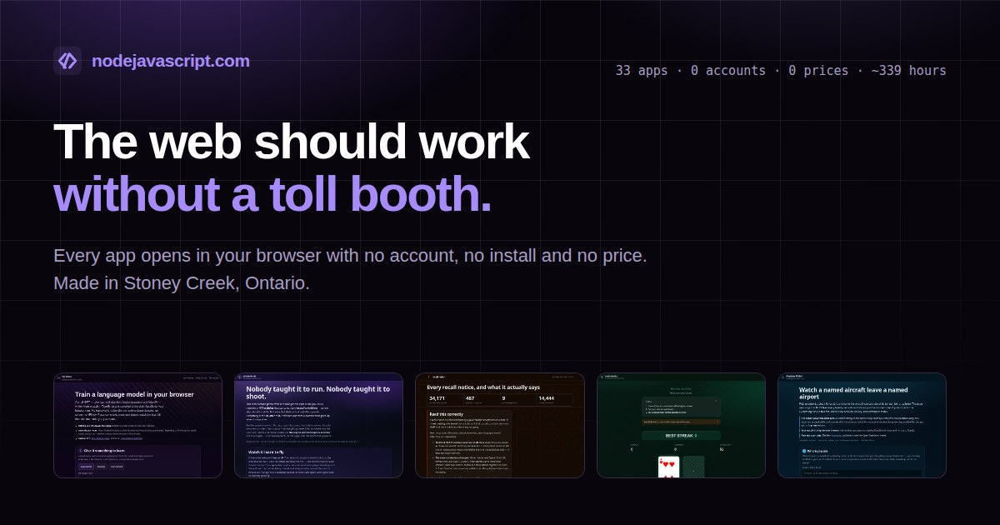</a>

Hamilton, Ontario, Canada

[georgefielder@gmail.com](mailto:georgefielder@gmail.com) · [LinkedIn](https://linkedin.com/in/georgefielder) · [nodejavascript.com](https://nodejavascript.com) · [datavisionstudios.com](https://datavisionstudios.com)

**Available now** — remote from Ontario, Canada (Eastern time), or hybrid within about an hour of Hamilton.

---

**Software should be handed over, not rented.** I build systems that run, publish their own source, and tell you plainly what they cannot do.

Thirty-two of them are pages you can open right now, plus one server you can read, all from [nodejavascript.com](https://nodejavascript.com/): **0 accounts, 0 prices**, and the cookie question is the only thing on the site that asks you anything. Every picture below is the deployed page itself, captured from the live host — click one and you are there.

You should not have to take a résumé's word for anything. Where an app cannot do something, its own page says so.

**[Watch it learn](#watch-it-learn)** · 8 apps · **[Play & tinker](#play--tinker)** · 6 apps · **[Places & stories](#places--stories)** · 6 apps · **[Check a record](#check-a-record)** · 10 apps · **[Under the hood](#under-the-hood)** · 3 apps

## Watch it learn

*Small models learning in the open — some in your tab, some behind it.*

| | |
|---|---|
| <a href="https://llm-demo.nodejavascript.com/">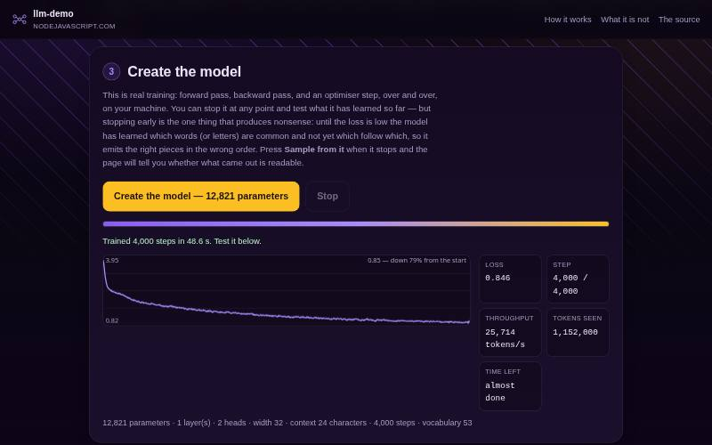</a> **[LLM demo](https://llm-demo.nodejavascript.com/)** A small GPT written from scratch in TypeScript and trained in your own browser — nothing you type leaves the page. TypeScript · no dependencies · GPT from scratch · Web Worker · Canvas charts | <a href="https://rag-demo.nodejavascript.com/">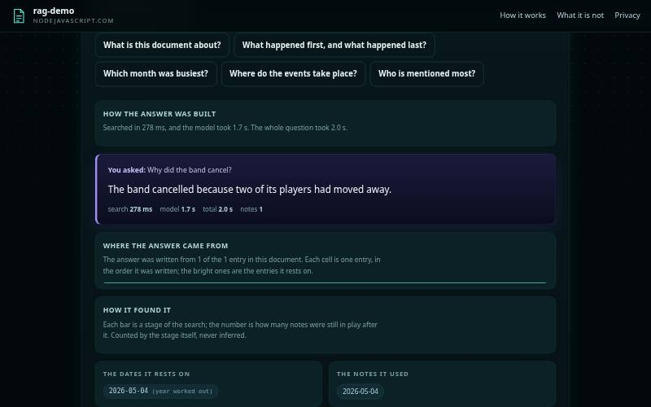</a> **[RAG demo](https://rag-demo.nodejavascript.com/)** Paste an article, a diary, a resume or a set of terms, then ask it questions. Every answer quotes the document — and shows the dates, places and people it rests on. TypeScript · Node.js · SQLite · Canvas charts |
| <a href="https://moon-lander.nodejavascript.com/">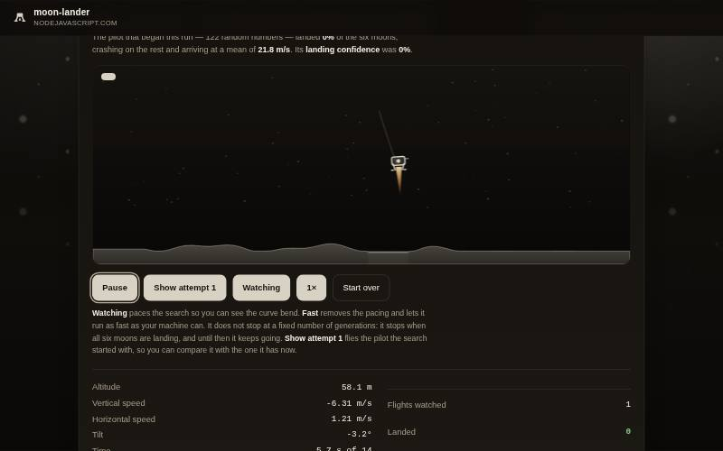</a> **[Moon lander](https://moon-lander.nodejavascript.com/)** A lander that shows you its failures. It wrecks every attempt for its first 360 generations, then learns to find the one flat piece of ground on the site by feel alone — and the whole search runs in your browser. JavaScript · Canvas · Web Worker · search-based learning | <a href="https://vision-ml-demo.nodejavascript.com/">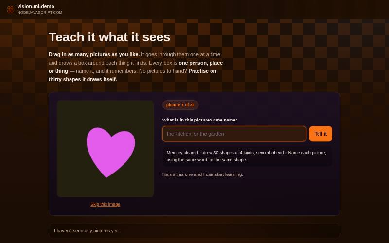</a> **[Vision ML demo](https://vision-ml-demo.nodejavascript.com/)** Show it a picture, name what is in it, and watch a small vision model learn the things you name — on your own machine, with thirty practise shapes built in, four hard kinds and several of each. TypeScript · no dependencies · Web Worker · IndexedDB · Canvas charts |
| <a href="https://circle-ml.nodejavascript.com/">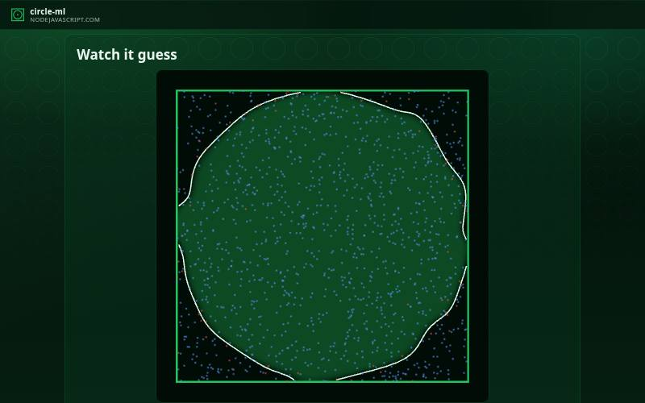</a> **[Circle ML](https://circle-ml.nodejavascript.com/)** A network that has never been told what a circle is. It is shown two numbers, told only whether it was right, and the boundary it arrives at is drawn on the page — no circle is drawn for it anywhere. TypeScript · three.js · WebGL · Canvas charts | <a href="https://pong-ml.nodejavascript.com/">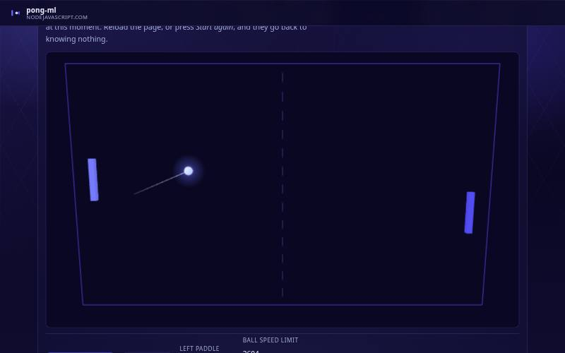</a> **[Pong ML](https://pong-ml.nodejavascript.com/)** Two paddles learn to play Pong in your browser, each paid for the trouble it gives the other one rather than for winning — and the page works out the ball speed above which no paddle can get there in time. TypeScript · three.js · Canvas charts · Web Worker |
| <a href="https://asteroids-ml.nodejavascript.com/">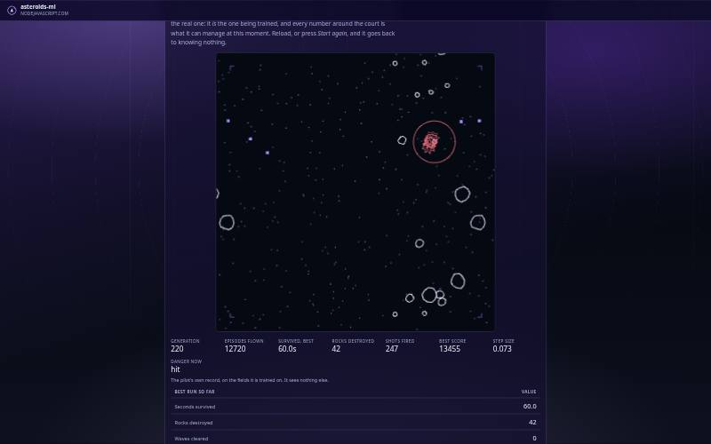</a> **[Asteroids ML](https://asteroids-ml.nodejavascript.com/)** A ship taught to play Asteroids in your own tab, weights and all — nobody taught it to shoot, and staying alive longer turns out to mean shooting. TypeScript · three.js · Web Worker · hill climbing | <a href="https://lottery-odds.nodejavascript.com/">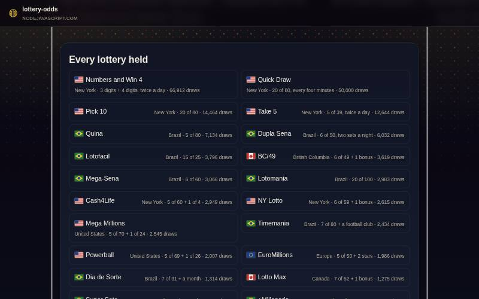</a> **[Lottery odds](https://lottery-odds.nodejavascript.com/)** Nineteen lottery histories, one page each, and the finding they all share: the draw cannot be predicted, but the crowd can be avoided — so every page names a line to play and why. Python build · three fitted models · backtest · JSON data · static page |

## Play & tinker

*Games that learn, and toys that do one thing well.*

| | |
|---|---|
| <a href="https://redqueen-vs-sharks-with-laser-beams-attached-to-their-heads.nodejavascript.com/">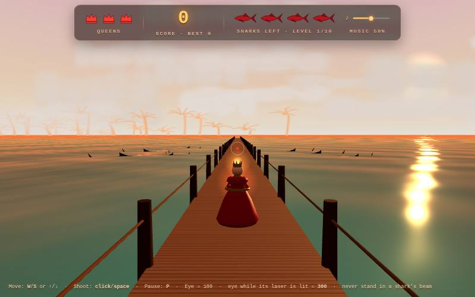</a> **[Red Queen vs. Laser Sharks](https://redqueen-vs-sharks-with-laser-beams-attached-to-their-heads.nodejavascript.com/)** A sunset pier, three lives and ten levels of sharks with lasers bolted to their heads. Every shark that kills you had to look at you first. JavaScript · three.js · WebGL · Node.js server · Web Audio | <a href="https://card-sharks.nodejavascript.com/">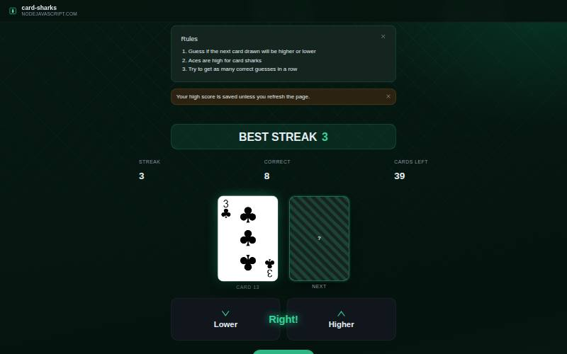</a> **[Card sharks](https://card-sharks.nodejavascript.com/)** Guess higher or lower and build your longest streak. React · Ant Design |
| <a href="https://sudoku-ml.nodejavascript.com/">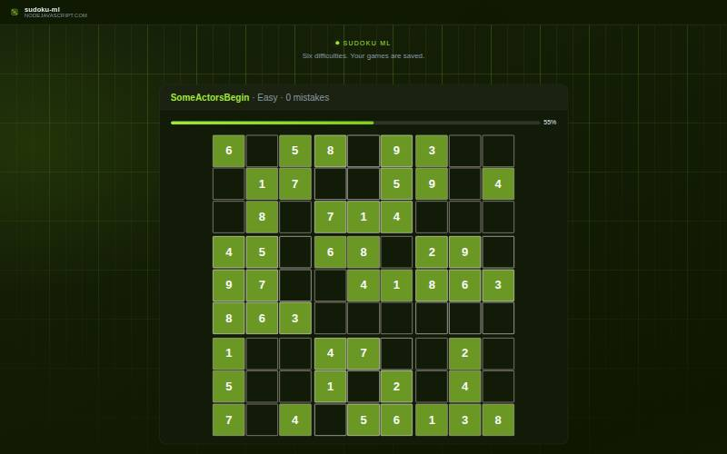</a> **[Sudoku ML](https://sudoku-ml.nodejavascript.com/)** Six difficulties of Sudoku, played in your browser — your games and your mistakes are saved as you play. React · Ant Design · Apollo Client · Encrypt Storage | <a href="https://stellar-forge.nodejavascript.com/">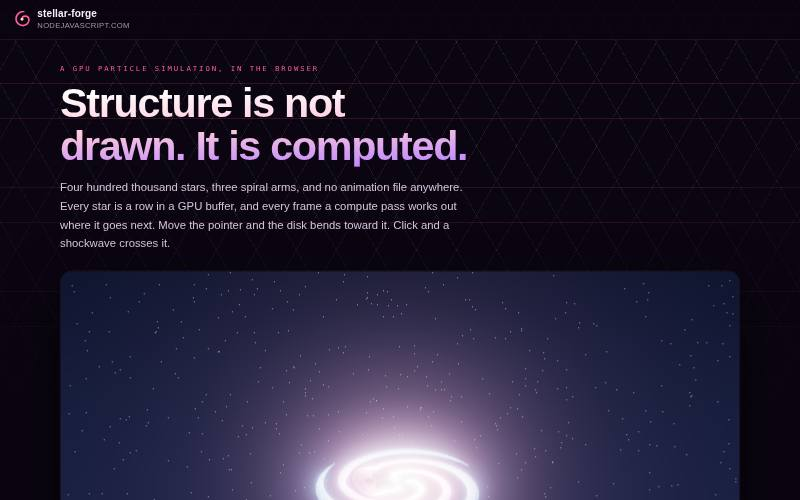</a> **[Stellar Forge](https://stellar-forge.nodejavascript.com/)** A three-armed spiral of 400,000 stars, solved on the GPU every frame — move the pointer to bend it, click to send a shockwave. three.js · WebGPU compute · WebGL 2 fallback |
| <a href="https://password-please.nodejavascript.com/">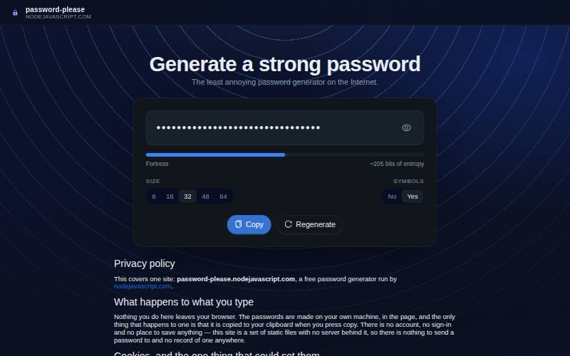</a> **[Password please](https://password-please.nodejavascript.com/)** Generate strong, copy-ready passwords in one click. React · Ant Design | <a href="https://word-cloud.nodejavascript.com/">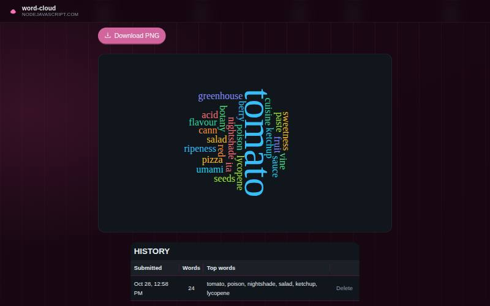</a> **[Word cloud](https://word-cloud.nodejavascript.com/)** Turn any text into a word cloud in seconds. React · Ant Design · Ant Design Charts · save-svg-as-png |

## Places & stories

*Maps, family trees and small sites about the world.*

| | |
|---|---|
| <a href="https://airplane-watch.nodejavascript.com/">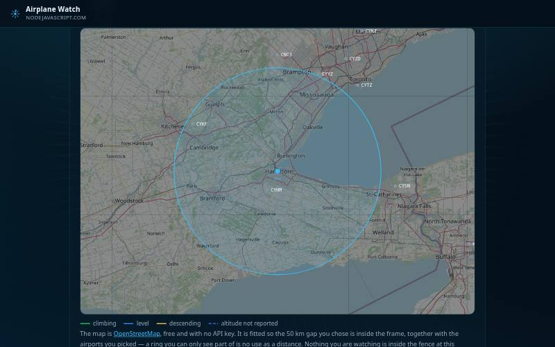</a> **[Airplane Watch](https://airplane-watch.nodejavascript.com/)** Name a place or an airport, and watch the aircraft in the air around it — told the moment a watched one is airborne. TypeScript · SVG map · PostgreSQL survey · static page | <a href="https://hominin-atlas.nodejavascript.com/">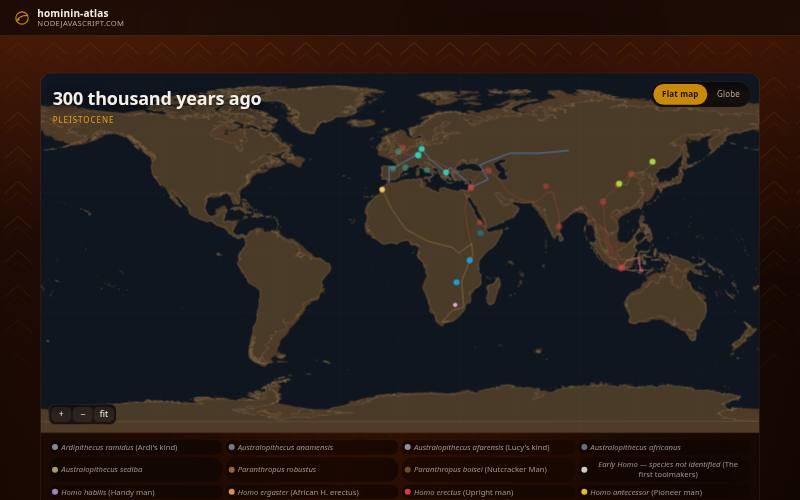</a> **[Hominin Atlas](https://hominin-atlas.nodejavascript.com/)** Every hominin on one map: where each was found, when it lived, and how much of the genome moved between them. TypeScript · three.js · world-atlas · Canvas globe · static page |
| <a href="https://antitomato.com/">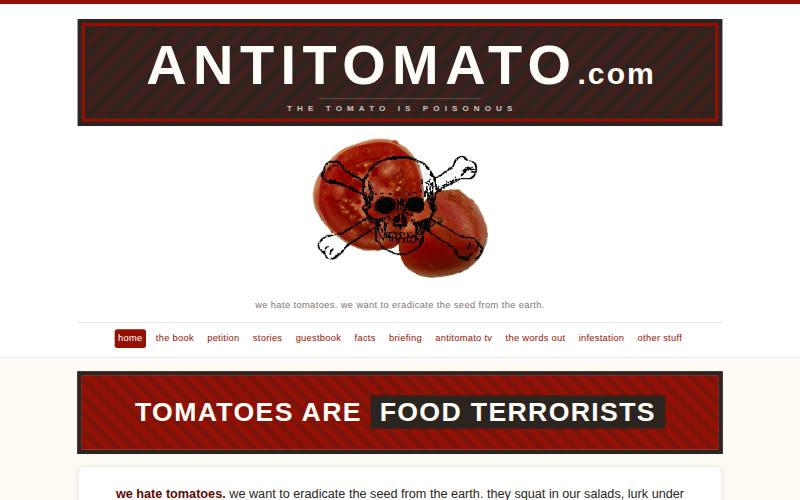</a> **[antitomato.com](https://antitomato.com/)** The original anti-tomato protest site, revived — the petition, the stories, the CBC feature and a daily tomato-threat news wire. JavaScript · Next.js · React · PostgreSQL | <a href="https://gord100.nodejavascript.com/">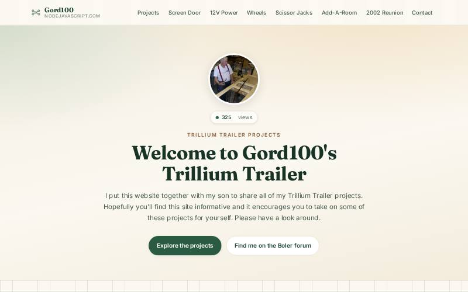</a> **[gord100](https://gord100.nodejavascript.com/)** Ten Trillium Trailer projects with build guides — screen door, 12V power, bike rack — built with his son. Express · Pug templates · Helmet · Grunt |
| <a href="https://bass-family.nodejavascript.com/">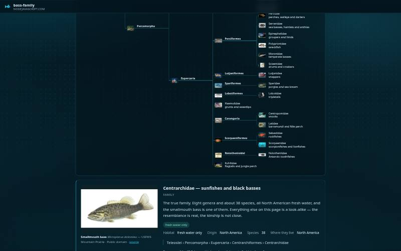</a> **[Bass Family](https://bass-family.nodejavascript.com/)** Eighty-three fishes that get called a bass, drawn on the tree they actually sit on — and why a shared shape is not a family. JavaScript · SVG cladogram · static page | <a href="https://tiny-voice.nodejavascript.com/">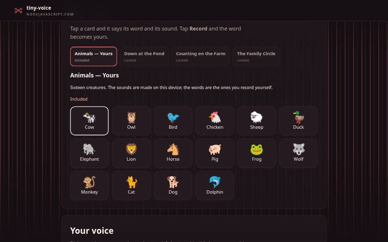</a> **[tiny-voice](https://tiny-voice.nodejavascript.com/)** Word packs for a child's iPad, narrated in the parent's own voice — recorded on the device, kept on the device, with no account and no advert. TypeScript · Web Audio · MediaRecorder · IndexedDB · static page |

## Check a record

*Public documents made readable: your food, your pay, your campus, your company.*

Every page in this chapter: No runtime dependencies · Node.js 22 · Static HTML · SVG charts

| | |
|---|---|
| <a href="https://recallradar.nodejavascript.com/">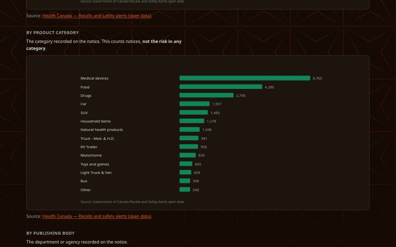</a> **[Recall Radar](https://recallradar.nodejavascript.com/)** A recall is a fact a government already publishes. This puts it where you can search it — by brand, by category, by the month it was issued — with the notice itself linked. | <a href="https://kitchen-file.nodejavascript.com/">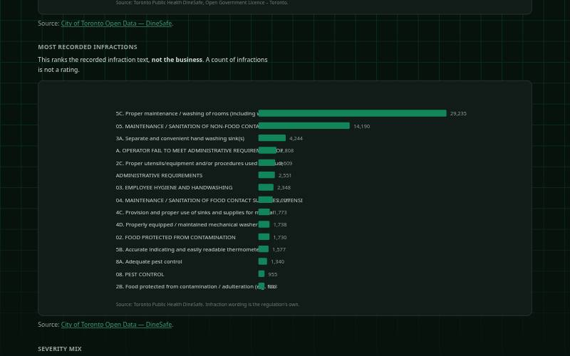</a> **[Kitchen File](https://kitchen-file.nodejavascript.com/)** What the inspector actually wrote, for every food premises in Toronto: the pass, the conditional pass, the closure, and the infractions on the report. |
| <a href="https://before-you-sign.nodejavascript.com/">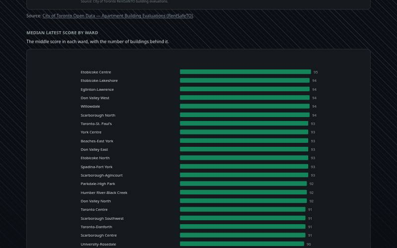</a> **[Before You Sign](https://before-you-sign.nodejavascript.com/)** Sign nothing about a building you have not read the record on. The city's own evaluation of the building, on one page, before the lease. | <a href="https://safe-to-eat.nodejavascript.com/">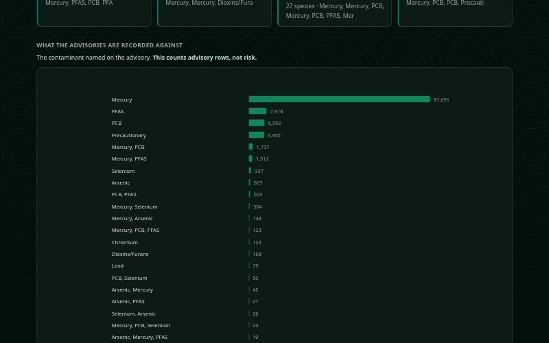</a> **[Safe to Eat](https://safe-to-eat.nodejavascript.com/)** The province's own advice on fish, waterbody by waterbody — with the guide's own codebook linked rather than translated, because a wrong translation is health advice. |
| <a href="https://company-file.nodejavascript.com/">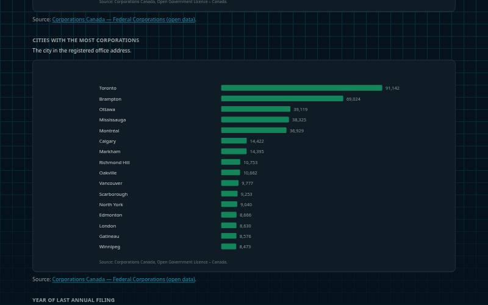</a> **[Company File](https://company-file.nodejavascript.com/)** Before you contract with a company, check that it exists. Every federal corporation, its status and its history, searchable. | <a href="https://campus-record.nodejavascript.com/">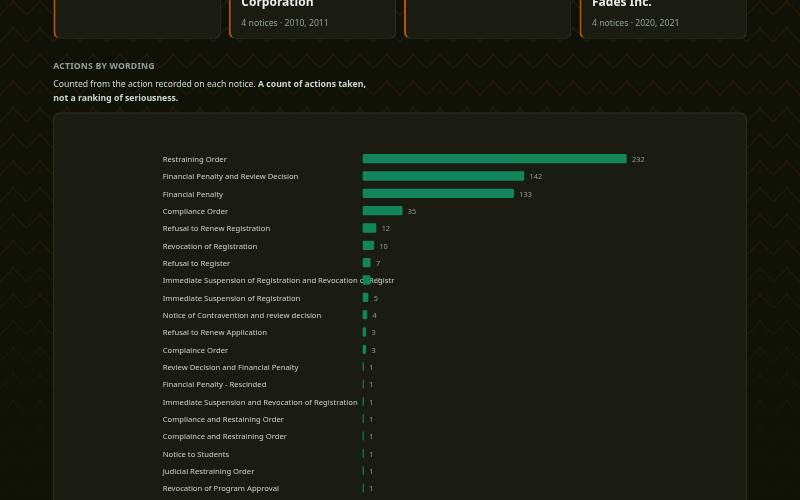</a> **[Campus Record](https://campus-record.nodejavascript.com/)** Every enforcement action Ontario has taken against a career college — notice, order, penalty — before anyone pays tuition. |
| <a href="https://work-file.nodejavascript.com/">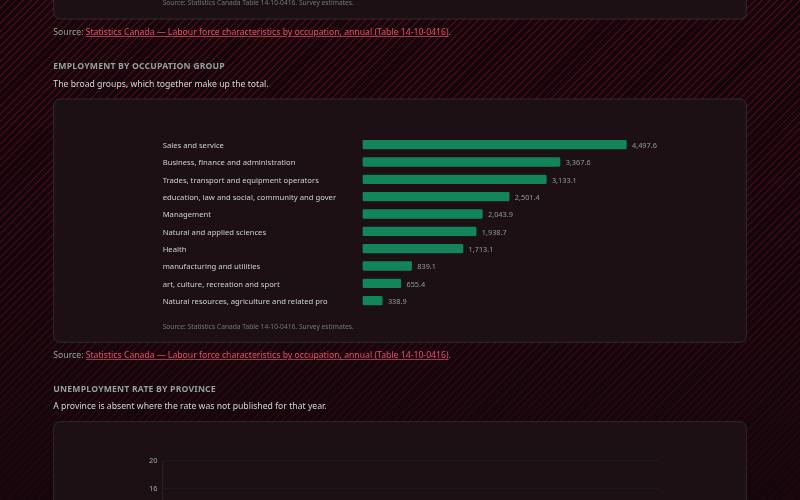</a> **[Work File](https://work-file.nodejavascript.com/)** How many people do this job, and where — from Statistics Canada's own table, with a gap drawn where a figure is suppressed rather than a zero invented. | <a href="https://what-it-costs.nodejavascript.com/">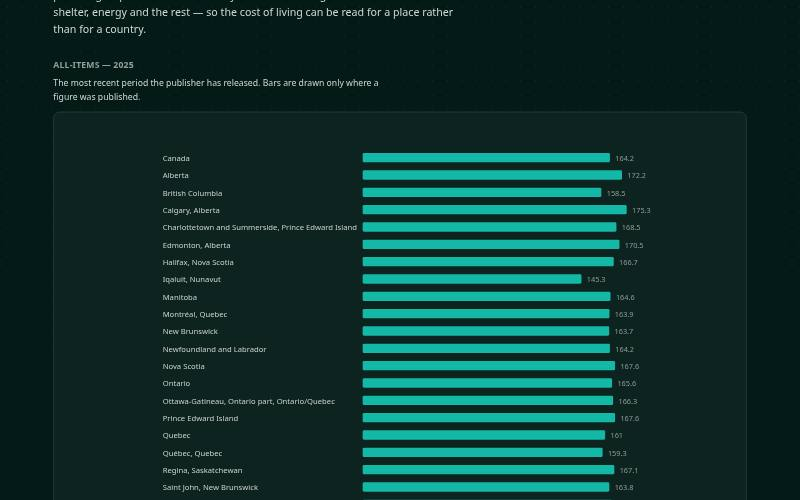</a> **[What It Costs](https://what-it-costs.nodejavascript.com/)** A cost of living is not an opinion, it is a published figure. The Consumer Price Index for the city you actually live in, year by year. |
| <a href="https://pay-file.nodejavascript.com/">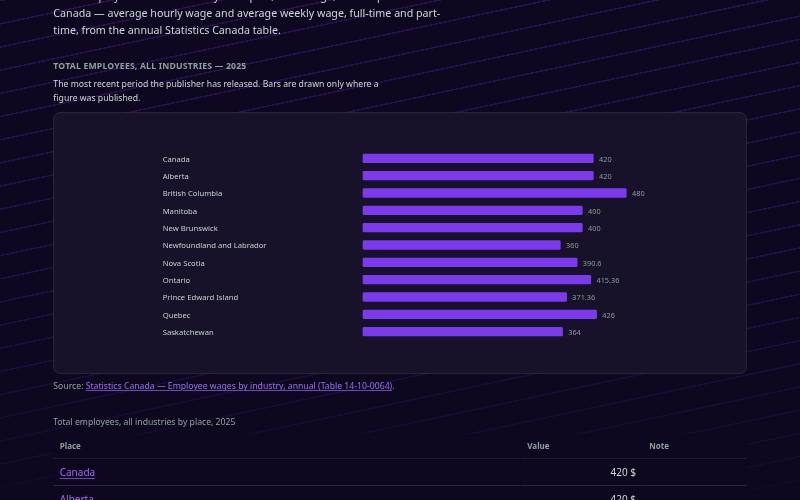</a> **[Pay File](https://pay-file.nodejavascript.com/)** What a job pays is a published figure, not a rumour. Average hourly and weekly wages by industry and province — the record, never a ranking of who is best. | <a href="https://pop-file.nodejavascript.com/">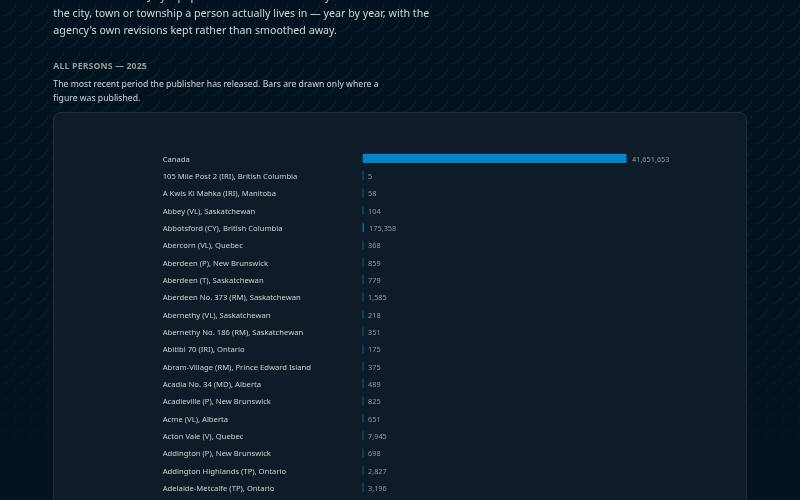</a> **[Pop File](https://pop-file.nodejavascript.com/)** How many people live in your own municipality — Statistics Canada's July 1 estimate, year by year, kept as an estimate rather than called a count. |

## Under the hood

*The pieces that are more than a page: a radio, a name for sale, and a broker that runs all night.*

| | |
|---|---|
| <a href="https://domainnamesale.nodejavascript.com/">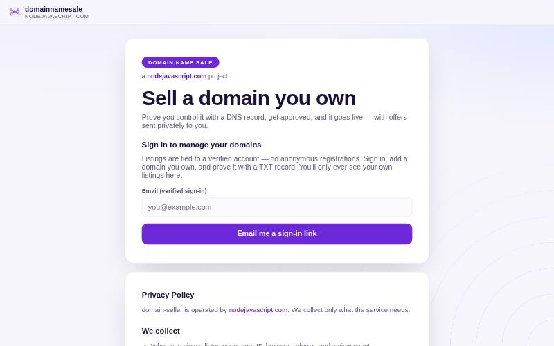</a> **[Domain Name Sale](https://domainnamesale.nodejavascript.com/)** List a domain you own for sale — prove it with a DNS record, get approved, and take private offers. TypeScript · Next.js · React · PostgreSQL | <a href="https://fm-radio.nodejavascript.com/">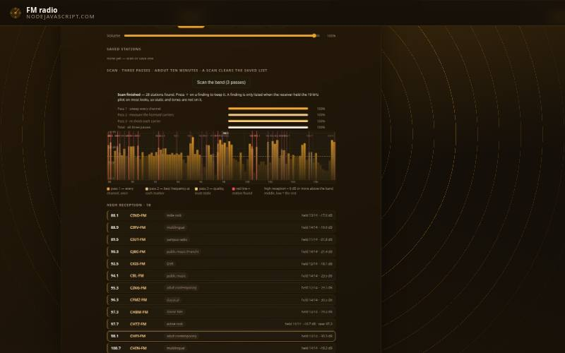</a> **[FM radio](https://fm-radio.nodejavascript.com/)** Tune a USB FM radio from a browser page — the scan only calls a channel a station when the 19 kHz pilot is really there, so its list stays short. Python · standard-library HTTP server · Canvas charts · Docker · No runtime dependencies |
| **[MQTT broker](https://github.com/nodejavascript/mqtt-broker-aedes)** A self-hosted MQTT broker with persistence and auth — TypeScript, Docker-ready, open source. TypeScript · Aedes · LevelDB · Docker |  |

## What I do

**Agentic AI, in production.** I write Model Context Protocol servers — stdio and streamable HTTP — that connect models to real tools and real data: Google Workspace, Cloudflare, GitHub and GitLab CI, databases, payments, fax, legal research. They run under a Visual Studio Code agent workspace of custom agent modes and skills, with an automation agent that has host-filesystem access, persistent browser control, local model inference and vector memory in Qdrant. On top of that: retrieval and embeddings, document and optical-character-recognition pipelines, grounded answers with citations, real-time voice pipelines, tool calling, prompt-injection defence, and consent-gated verification that fails closed.

**Full-stack at scale.** Principal engineer and architect: in a platform's TypeScript gateway I wrote about 3,300 of its 3,385 commits and built the clustered real-time engine inside it. Before that, three highly available API gateways carrying ten million records a month, and the Illinois State Board of Education platform — TypeScript, GraphQL and React over MongoDB, moving children's records between schools under zero-trust security. React and Next.js at the front, PostgreSQL, MongoDB, Redis and SQL Server behind it, on Amazon Web Services, Google Cloud and Azure, with observability that means something (OpenTelemetry, Prometheus, Grafana) and zero-trust security (OAuth2, JWT, single sign-on).

**Measured, not asserted.** Three kinds of test on every project — unit, end-to-end against a real browser, and against the deployed host — because a claim that is not measured is a claim. Zero runtime dependencies wherever a dependency is not earning its place, and free tiers only: self-hosted where a free tier cannot do the job.

## How I work with a team

- **Led and delivered with a team** at IOU Concepts — hired, then built a test-driven GraphQL API and React application with them, and documented it so a team that knew only Angular could take it over.
- **Trained a team through its Node.js transition** at LabX Media Group, and managed overseas developers through delivery at Conversion Media Group.
- **Ran the production estate** at Utherverse Digital — Docker, bare-metal hosts and PM2-managed services — and the observability that made it visible.
- **Reviewed the diff, not the summary**, and left every repository readable by whoever picks it up next.

## Selected results

- A GraphQL and React platform built for the **Illinois State Board of Education**, used by students, parents and faculty across the state (IOU Concepts / Xocial).
- A real-time lead generation engine producing **$3 million in monthly revenue**, and the ETL workflows behind it (Zeta Global).
- **Three RESTful API gateways processing 10 million records a month** on a federated GraphQL platform (Conversion Media Group).
- A patient management and laser-surgery scheduling database grown from **one clinic to about 76 clinics across four countries**, holding **600,000+ appointment records** (ICON Laser Eye Centers).
- Node.js applications serving **more than 2 million buy-and-sell users** (LabX Media Group).

## Skills

agentic AI, Model Context Protocol, retrieval and evaluation harnesses, fail-closed guardrails, embeddings, vector search, Ollama, OpenAI, TensorFlow, Amazon Comprehend, Amazon Rekognition, machine learning, TypeScript, JavaScript, Node.js, Python, Go, .NET Framework, ASP.NET, T-SQL, SQL, ColdFusion, CSS, React, Next.js, Angular, Express, Pug, GraphQL, Apollo client and server, RESTful APIs, WebSockets, three.js, WebGL, WebGPU, Web Worker, Canvas, SVG, Web Audio, IndexedDB, Rails, MQTT, Aedes, PostgreSQL, MongoDB, Microsoft SQL Server, Redis, SQLite, Qdrant, Meilisearch, Microsoft Access, LevelDB, RabbitMQ, ETL, data warehousing, database design, data modelling, indexing and execution plans, reporting, reconciliation, data quality, Amazon Web Services, Cloudflare Workers, Docker, PM2, Linux, Apache, Node.js clustering, load balancing, OpenTelemetry, Prometheus, Grafana, Datadog, CI/CD, Git, GitHub Actions, release management, performance optimisation, web hosting, application deployment, infrastructure support, OAuth2, JWT, single sign-on, zero-trust security, security models, Helmet, test-driven development, unit testing, end-to-end tests, API test automation, solution architecture, technical leadership, scrum, agile, product ownership, SR&ED management, project planning, fixed-price scoping, business analysis, documentation, UX/UI, full-stack development

## Open to

Senior and staff full-stack and AI engineering roles — remote, or hybrid within about an hour of Hamilton. Full-time or contract.

---

Everything above is live at [nodejavascript.com](https://nodejavascript.com/) and the source is in [the public repositories](https://github.com/nodejavascript?tab=repositories).
