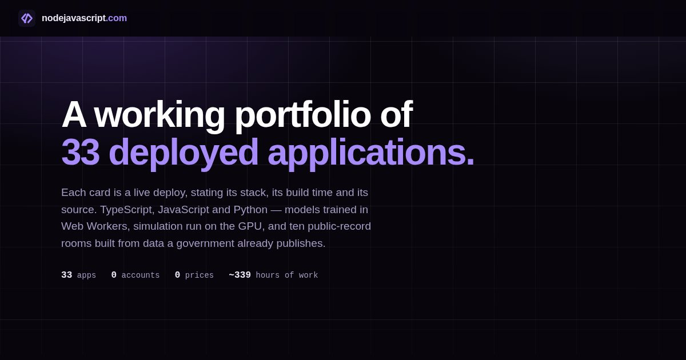

[georgefielder@gmail.com](mailto:georgefielder@gmail.com) · [LinkedIn](https://linkedin.com/in/georgefielder) · [nodejavascript.com](https://nodejavascript.com)

## Open to

Senior and staff full-stack and AI engineering roles — remote, or hybrid in southern Ontario. Full-time or contract.

## Skills

agentic AI, Model Context Protocol, retrieval and evaluation harnesses, fail-closed guardrails, embeddings, vector search, Ollama, OpenAI, TensorFlow, Amazon Comprehend, Amazon Rekognition, machine learning, TypeScript, JavaScript, Node.js, Python, Go, .NET Framework, ASP.NET, T-SQL, SQL, ColdFusion, CSS, React, Next.js, Angular, Express, Pug, GraphQL, Apollo client and server, RESTful APIs, WebSockets, three.js, WebGL, WebGPU, Web Worker, Canvas, SVG, Web Audio, IndexedDB, Rails, MQTT, Aedes, PostgreSQL, MongoDB, Microsoft SQL Server, Redis, SQLite, Qdrant, Meilisearch, Microsoft Access, LevelDB, RabbitMQ, ETL, data warehousing, database design, data modelling, indexing and execution plans, reporting, reconciliation, data quality, Amazon Web Services, Cloudflare Workers, Docker, PM2, Linux, Apache, Node.js clustering, load balancing, OpenTelemetry, Prometheus, Grafana, Datadog, CI/CD, Git, GitHub Actions, release management, performance optimisation, web hosting, application deployment, infrastructure support, OAuth2, JWT, single sign-on, zero-trust security, security models, Helmet, test-driven development, unit testing, end-to-end tests, API test automation, solution architecture, technical leadership, scrum, agile, product ownership, SR&ED management, project planning, fixed-price scoping, business analysis, documentation, UX/UI, full-stack development

## Watch it learn

*Learning in the browser: a GPT trained from scratch, retrieval over a pasted document, image classification and three trained controllers.*

| | |
|---|---|
|  **[LLM demo](https://llm-demo.nodejavascript.com/)** A GPT written from scratch in TypeScript with no dependencies — tokeniser, self-attention, hand-derived backpropagation and AdamW all explicit — trained and sampled in a Web Worker, so the tab never blocks and no prompt leaves the browser. TypeScript · no dependencies · GPT from scratch · Web Worker · Canvas charts |  **[RAG demo](https://rag-demo.nodejavascript.com/)** Retrieval that shows its work: the document is chunked, embedded and searched, and every answer cites the passages it used beside the dates, places and people it pulled out. Inference on Cloudflare Workers AI, so the answer can be checked. TypeScript · Node.js · SQLite · Canvas charts |
|  **[Moon lander](https://moon-lander.nodejavascript.com/)** A search-based controller rather than a gradient-trained one: each attempt is scored, the search runs in a Web Worker, and the page plots what each generation achieved. The first 360 generations fail on the published score. JavaScript · Canvas · Web Worker · search-based learning |  **[Vision ML demo](https://vision-ml-demo.nodejavascript.com/)** An image classifier trained in the browser on labels you supply: a Web Worker trains so the tab stays responsive, weights persist in IndexedDB, and loss and per-class accuracy are charted, with thirty practise shapes built in. TypeScript · no dependencies · Web Worker · IndexedDB · Canvas charts |
|  **[Circle ML](https://circle-ml.nodejavascript.com/)** Points are scattered at random across a square and labelled only inside or outside the circle. A binary classifier given that one bit of feedback and no geometric prior draws the boundary itself in WebGL — the fit visible, not described. TypeScript · three.js · WebGL · Canvas charts |  **[Pong ML](https://pong-ml.nodejavascript.com/)** Two agents trained against each other, rewarded by the difficulty each causes the other rather than by winning. The page solves for the ball speed past which no paddle can intercept in time — a limit computed, not guessed. TypeScript · three.js · Canvas charts · Web Worker |
|  **[Asteroids ML](https://asteroids-ml.nodejavascript.com/)** Hill climbing rather than backpropagation: a controller is scored on survival time in a Web Worker and keeps whichever change lives longer. Shooting emerged from that reward — nobody scripted it. TypeScript · three.js · Web Worker · hill climbing |  **[Lottery odds](https://lottery-odds.nodejavascript.com/)** Nineteen draw histories, three fitted models and a backtest against the draws themselves. No model beats chance, which is the finding; what the page can do is avoid crowd-picked numbers, and it shows the arithmetic per line. Python build · three fitted models · backtest · JSON data · static page |

## Play & tinker

*Real-time Canvas and WebGL games, a password generator, a word-cloud renderer and a card game — all client-side.*

| | |
|---|---|
|  **[Red Queen vs. Laser Sharks](https://redqueen-vs-sharks-with-laser-beams-attached-to-their-heads.nodejavascript.com/)** Ten levels, three lives, and one rule that makes the fairness arithmetic: a shark cannot fire until it has turned to face you. The rules live in their own module behind three.js, with a Node server for the shared board. JavaScript · three.js · WebGL · Node.js server · Web Audio |  **[Card sharks](https://card-sharks.nodejavascript.com/)** Higher-or-lower in React on Ant Design components: each guess is scored against the probability of the next draw, and the best streak is kept as you play rather than reset with the page. React · Ant Design |
|  **[Sudoku ML](https://sudoku-ml.nodejavascript.com/)** Six difficulties in React, with Apollo Client for data and Encrypt Storage writing games and mistakes to the device — so a half-finished board is still there next visit. React · Ant Design · Apollo Client · Encrypt Storage |  **[Stellar Forge](https://stellar-forge.nodejavascript.com/)** 400,000 stars integrated on the GPU every frame — WebGPU compute with a WebGL 2 fallback picked at runtime — with pointer input bending the arms and a click sending a shockwave through the field. three.js · WebGPU compute · WebGL 2 fallback |
|  **[Password please](https://password-please.nodejavascript.com/)** Generated in the client with a length and character-set control, so no candidate is transmitted and there is no server that could log one. React on Ant Design; the whole tool is one page. React · Ant Design |  **[Word cloud](https://word-cloud.nodejavascript.com/)** Frequency ranking done in the browser, then laid out with Ant Design Charts and exported as SVG or PNG — so the image is a real vector rather than a screenshot, and the text is never uploaded. React · Ant Design · Ant Design Charts · save-svg-as-png |

## Places & stories

*Maps, a globe and a cladogram over published geometry — live aircraft positions, hominin finds, a news wire, trailer builds.*

| | |
|---|---|
|  **[Airplane Watch](https://airplane-watch.nodejavascript.com/)** Live positions from the adsb.lol feed over OpenStreetMap tiles, with a PostgreSQL airport survey resolving a place name to an airport code; a watched airframe raises a notice when it departs, and the fence is drawn rather than described. TypeScript · SVG map · PostgreSQL survey · static page |  **[Hominin Atlas](https://hominin-atlas.nodejavascript.com/)** A globe over world-atlas geometry with every hominin find placed where it was recovered, dated to the range the paper gives, and joined by the genetic evidence for flow between lineages — each figure carrying its source. TypeScript · three.js · world-atlas · Canvas globe · static page |
|  **[antitomato.com](https://antitomato.com/)** Next.js and PostgreSQL: the original petition, the collected stories, and a wire that polls Google News for tomato coverage. Submissions pass Cloudflare Turnstile, so the petition is not a spam target. JavaScript · Next.js · React · PostgreSQL |  **[gord100](https://gord100.nodejavascript.com/)** Ten trailer builds written up as guides and served by Express from Pug templates — Helmet for headers, Gmail for contact, and nothing dynamic where nothing needed to be. Express · Pug templates · Helmet · Grunt |
|  **[Bass Family](https://bass-family.nodejavascript.com/)** Eighty-three fishes that carry the name bass, plotted on the cladogram their genetics actually gives and drawn as SVG, because a shared shape is convergence, not kinship. JavaScript · SVG cladogram · static page |  **[tiny-voice](https://tiny-voice.nodejavascript.com/)** Recorded in the parent's own voice with Web Audio and MediaRecorder, stored in IndexedDB on the device, played from a board a child can use — no upload, no account, no advertising. TypeScript · Web Audio · MediaRecorder · IndexedDB · static page |

## Check a record

*Public records indexed and searchable — inspections, recalls, wages, prices, populations, filings — each linked to source.*

Every page in this chapter: No runtime dependencies · Node.js 22 · Static HTML · SVG charts

| | |
|---|---|
|  **[Recall Radar](https://recallradar.nodejavascript.com/)** A static index over recalls the government already publishes: searchable by brand, category and issue month, with every entry linking to the notice it came from. Node 22 build, SVG charts, no client dependencies. **[Kitchen File](https://kitchen-file.nodejavascript.com/)** Toronto food-premises inspections as the inspector wrote them: pass, conditional pass, closure, and the infractions. Built at build time into static pages with SVG charts, so it carries no runtime dependency and no query to log. |
|  **[Before You Sign](https://before-you-sign.nodejavascript.com/)** A building's own file before a lease is signed: the city's evaluation and enforcement history on one page, each claim linked to its source. Static HTML from a Node 22 pipeline, so nothing is queried at runtime. **[Safe to Eat](https://safe-to-eat.nodejavascript.com/)** Provincial fish advice per waterbody, with the guide's own codebook linked rather than translated — a mistranslation here would be health advice — built as static pages from a Node 22 pipeline. |
|  **[Company File](https://company-file.nodejavascript.com/)** Every federal corporation, its status and its filing history, published as static pages, with search running in the browser against a sharded index rather than against a server. **[Campus Record](https://campus-record.nodejavascript.com/)** Ontario career-college enforcement actions — notice, order, penalty — indexed per institution and per action, built as static pages so it can be read before tuition is paid. |
|  **[Work File](https://work-file.nodejavascript.com/)** Employment counts by occupation and region from Statistics Canada's table, with a suppressed cell drawn as a gap: a figure that was withheld is not a zero, and the page refuses to pretend otherwise. **[What It Costs](https://what-it-costs.nodejavascript.com/)** Consumer Price Index series by city and year, read from the published table and charted without adjustment — the number on the page is the number in the release, and the source is named. |
|  **[Pay File](https://pay-file.nodejavascript.com/)** Average hourly and weekly wages by industry and province from the published labour-force table, presented as the record it is — no ranking, no normalisation, no derived headline. **[Pop File](https://pop-file.nodejavascript.com/)** Municipal population estimates for July 1 of each year, published as static pages and kept labelled as estimates: a census count and an annual estimate are different figures and the page does not conflate them. |

## Under the hood

*The three that are more than a page: a Python radio server, a DNS-verified domain sale and an MQTT broker.*

| | |
|---|---|
|  **[Domain Name Sale](https://domainnamesale.nodejavascript.com/)** Next.js and PostgreSQL with ownership proved rather than claimed: the server resolves a DNS record before a listing goes live. Offers are private and submissions pass Cloudflare Turnstile. TypeScript · Next.js · React · PostgreSQL |  **[FM radio](https://fm-radio.nodejavascript.com/)** A Python standard-library HTTP server driving a USB FM radio. The scan only reports a station when the 19 kHz stereo pilot is present, so adjacent-channel noise never appears as an entry; the spectrum is drawn on Canvas. Python · standard-library HTTP server · Canvas charts · Docker · No runtime dependencies |
| **[MQTT broker](https://github.com/nodejavascript/mqtt-broker-aedes)** An MQTT broker on Aedes with LevelDB persistence and topic authorisation, shipped as a Docker image — the one piece of infrastructure here rather than a page, and the only thing on this list a server has to run. TypeScript · Aedes · LevelDB · Docker |  |

---

Everything above is live at [nodejavascript.com](https://nodejavascript.com/) and the source is in [the public repositories](https://github.com/nodejavascript?tab=repositories).
